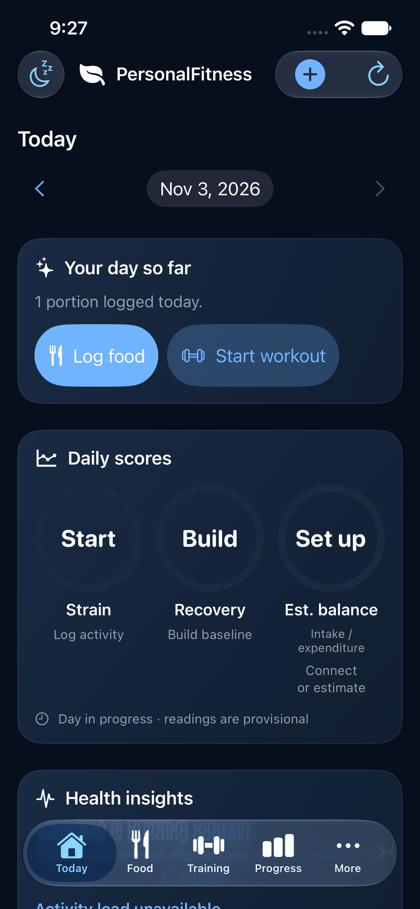
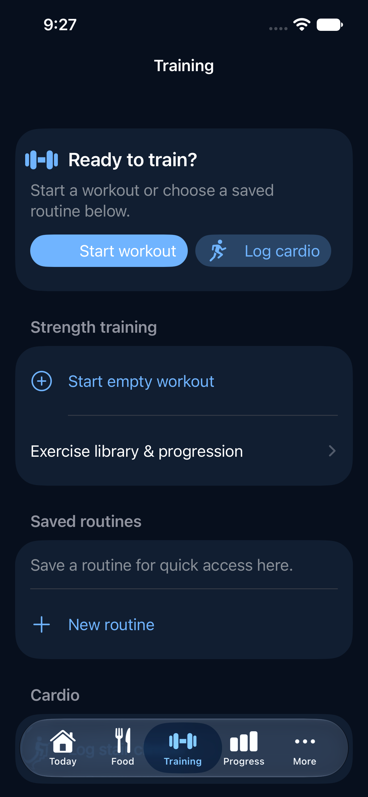
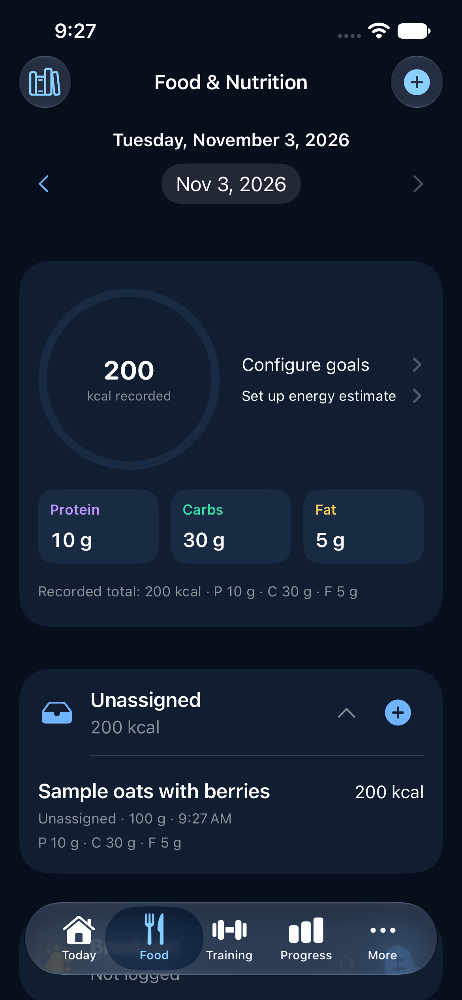
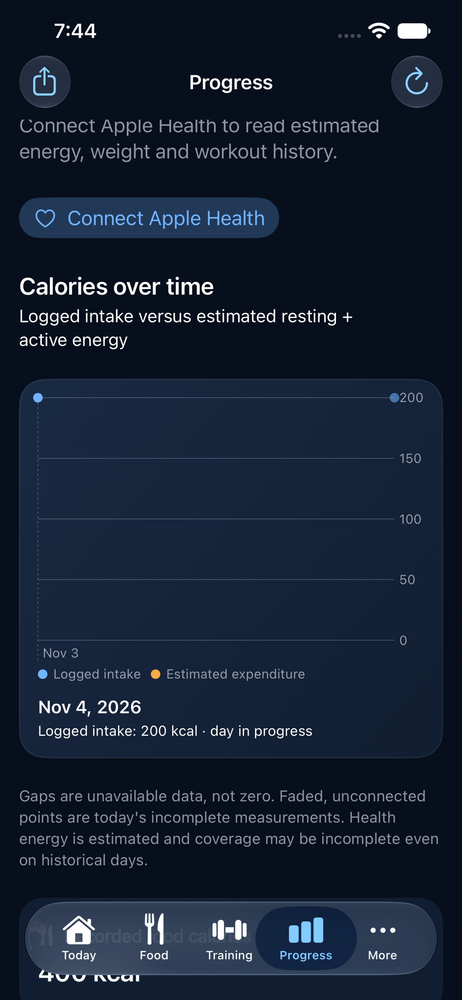

# PersonalFitness

PersonalFitness is a local-first native iPhone app for food, strength training, cardio and progress, with optional read-only Apple Health integration. It does not require an app account, backend, paid nutrition API, analytics service or cloud database. It has no Android client.

| Today | Training | Food | Progress |
| --- | --- | --- | --- |
|  |  |  |  |

Screenshots use isolated synthetic simulator fixtures, not personal Health measurements. See [verification notes](Verification/PremiumUXQualityGate/README.md) and [current state](docs/CURRENT_STATE.md).

## What is implemented

- Local food diary, saved foods and recipes, serving conversion and historical nutrition snapshots; offline food and exercise catalogs.
- Strength routines, resumable workouts, sets, cardio and stair climber; history and progression.
- Daily dashboard and date-range reports with calories, macros, workouts, weights and, where available, Health data; missing readings are not zeros.
- Optional, separately requested read-only Health activity, sleep and recovery inputs; widgets show locally shared, privacy-controlled snapshots.
- Transparent estimated expenditure, activity-load and Recovery heuristics. They are not clinical measurements and do not reproduce proprietary scores. [Methods](docs/SCORING.md).

## Requirements and quick start

A Mac with full Xcode and an iOS Simulator runtime is required. iOS deployment target: **17.0**. This checkout was verified with **Xcode 27.0** (Swift 6.4 compiler; project Swift language setting 5); older versions are not verified. The app uses Apple frameworks without third-party runtime packages. The optional calculation package uses Swift tools 5.9. Bundled offline catalog licenses are described in [OFFLINE_CATALOGS.md](OFFLINE_CATALOGS.md).

```sh
git clone https://github.com/sathvik2522/FitnessTracker.git
cd FitnessTracker
open PersonalFitness.xcodeproj
```

In Xcode select the **PersonalFitness** scheme and an available iPhone simulator. For commands, signing setup and the widget App Group caveat, see [Getting started](docs/GETTING_STARTED.md). Simulator builds need no Apple signing credentials. A physical iPhone build needs a suitable Apple developer team, matching app/widget profiles, HealthKit and a shared App Group; capabilities available to an account can vary. The existing App Group is owner-specific and must be configured consistently in four locations for another team. Changing identifiers can create a different on-device data container.

```sh
xcodebuild -project PersonalFitness.xcodeproj -scheme PersonalFitness \
  -destination 'generic/platform=iOS Simulator' CODE_SIGNING_ALLOWED=NO build
# Substitute an available UUID from: xcrun simctl list devices available
xcodebuild -project PersonalFitness.xcodeproj -scheme PersonalFitness \
  -destination 'platform=iOS Simulator,id=SIMULATOR_UUID' \
  -only-testing:PersonalFitnessTests CODE_SIGNING_ALLOWED=NO test
```

## Architecture, privacy and status

SwiftUI views use focused coordinators and stores; SwiftData stores local records; pure Swift modules implement nutrition, workout and scoring logic; HealthKit adapters query only after an explicit request. Widgets read a versioned App Group snapshot, not the SwiftData store. [Architecture](docs/ARCHITECTURE.md) · [Features](docs/FEATURES.md) · [HealthKit](docs/HEALTHKIT.md) · [Data and privacy](docs/DATA_AND_PRIVACY.md) · [Testing](docs/TESTING.md) · [Troubleshooting](docs/TROUBLESHOOTING.md).

Data stays on the device and local JSON export has **no in-app restore**. Deleting the app can delete its local data. Health data stays in Apple Health. Estimates can be incomplete or change, and are not measurements of fat gain/loss. Device Health reconciliation, real VoiceOver and uninterrupted full-suite verification remain open. [Current state](docs/CURRENT_STATE.md).

Contributions: [CONTRIBUTING.md](CONTRIBUTING.md). License: [MIT](LICENSE). Bundled third-party catalogs have separate attribution and license requirements; see [OFFLINE_CATALOGS.md](OFFLINE_CATALOGS.md).
